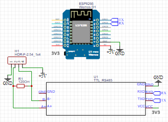

Схема подключение к esp


``` yaml
uart:
  tx_pin: 1
  rx_pin: 3
  id: uart_for_mercury
  baud_rate: 9600
  data_bits: 8
  parity: NONE
  stop_bits: 1
  
mercury200:
  id: mercury_id
  address:  386281
  uart_id: uart_for_mercury
  # dir_pin: 5
  all_commands: true
  startup_delay: 20s
  voltage: Voltage
  current: Current
  power: Power
  energy1: 
    name: Energy1
    id: Energy1
  energy2: 
    name: Energy2
    id: Energy2
  energy3: 
    name: Energy3
    id:  Energy3
  energy4: 
    name: Energy4
    id: Energy4
  battery_voltage: 
    name: Battery
    id: batvolt
  error: Error

sensor:
  - platform: template
    name: "Battery %"
    id: batpercent
    lambda: return id(batvolt).state;
    accuracy_decimals: 0
    unit_of_measurement: "%"
    icon: mdi:battery-medium
    filters:
      - calibrate_linear:
         method: exact
         datapoints:
          - 0.00 -> 0.0
          - 3.30 -> 1.0
          - 3.39 -> 10.0
          - 3.75 -> 50.0
          - 4.11 -> 90.0
          - 4.20 -> 100.0
      - lambda: |-
          if (x <= 100) {
            return x;
          } else {
            return 100;
          }
          if (x <0) {
            return 0;
          }
  - platform: template
    name: "Energy total"
    lambda: return id(Energy1).state + id(Energy2).state + id(Energy3).state + id(Energy4).state;
    update_interval: 60s  
    device_class: "power" 
    unit_of_measurement: "kW" 
    accuracy_decimals: 0

button:
  - platform: template
    name: Update counter
    entity_category: diagnostic
    on_press:
      - lambda: "id(mercury_id).update();"


```
